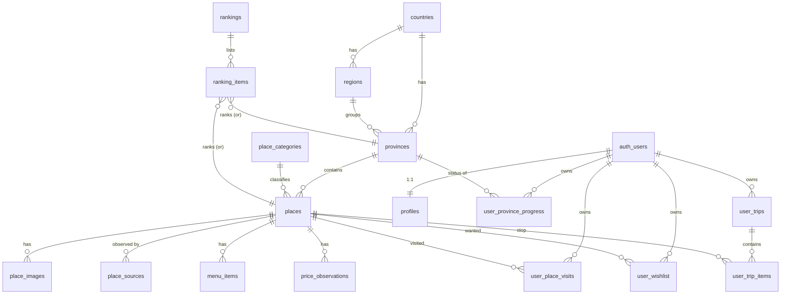

# Database design

Migrations: `supabase/migrations/` (apply in filename order). Seed: `supabase/seed.sql`
(generated by `npm run db:seed-sql` from the committed catalog JSON).

## Principles

- **Public catalog is separate from private user data.** Catalog tables are readable by
  everyone (only `published` places); user tables are owner-only via RLS.
- **RLS on every table.** Policies use `auth.uid()`; a client-supplied `user_id` is
  checked by `WITH CHECK`, never trusted. `anon` has no privileges on private tables.
- **Admin is a role in `profiles`**, checked by `public.is_admin()` (security definer)
  in policies and again on the server (`getAdminContext`). Users cannot change their
  own role (trigger `protect_profile_role`).
- **No duplicate tables per place type.** Restaurants, cafes, accommodation and
  activities are `places` rows with a `kind`; menus and prices are separate
  observation tables with explicit provenance.
- **Prices are observations, never “current”.** `price_observations.provenance` is one
  of `confirmed_provider`, `official_published`, `estimate`, with source and date.
- **Province status ≠ place visits.** `user_province_progress` and
  `user_place_visits` are independent.
- **Chat history is not stored** server-side (no `chat_sessions` tables) — chat history
  stays in the browser tab. Add tables only if the product enables history with consent.

## ER diagram



## Tables

| Table | Purpose | Key constraints |
|---|---|---|
| `countries`, `regions` | Geography hierarchy (Thailand now, more later) | PK codes |
| `provinces` | 77 Thai provinces (slug, ISO 3166-2, names, region, centroid) | `iso_code` unique |
| `place_categories` | Category vocabulary with TH/EN names | PK id |
| `places` | Every place (attraction/restaurant/cafe/accommodation/activity) with provider, external id, source URL, license, fetched date, status, data label | unique `(provider, external_id)`, unique `(province_slug, slug)`, name required, lat/lng ranges |
| `place_images` | Licensed images with author/license/source and review status | unique `(place_id, url)` |
| `place_sources` | Raw per-provider observations (keeps conflicts visible) | unique `(place_id, provider, external_id)` |
| `menu_items` | Menu names/prices **only when sourced** (source URL + date required) | |
| `price_observations` | Admission / room-night / avg-spend / menu prices with provenance | `amount_max ≥ amount_min` |
| `rankings`, `ranking_items` | Curated or data-based lists with stated basis and as-of date | label `editor_pick`/`data_based` |
| `data_sync_logs` | Sync runs and errors (admin only) | |
| `profiles` | Display name/avatar/locale/role (created on sign-up by trigger) | role ∈ user/admin |
| `user_province_progress` | Province status: `visited` / `want` (absent = not visited) | PK `(user_id, province_slug)` |
| `user_place_visits` | Visit date, private note, rating 1–5, tags, photo paths, `is_public=false` | unique `(user_id, place_id)` |
| `user_wishlist` | Places the user wants to visit | PK `(user_id, place_id)` |
| `user_trips`, `user_trip_items` | Trip plans; items by day/position with user-entered cost estimate | unique `(trip_id, place_id)`; item's trip must belong to the same user |

Storage: private bucket `visit-photos`, object path must start with the owner's user id.

## Making a user an admin

Run in the Supabase SQL editor (as the project owner):

```sql
update public.profiles set role = 'admin' where id = '<user uuid from auth.users>';
```

## Verified by tests

`tests/rls.test.ts` runs these migrations in PGlite (Postgres in WASM) with stand-ins for
Supabase's `auth`/`storage` schemas and checks: owner-only access, rejected cross-user
inserts/updates/deletes, anon denied on private tables, no self-promotion to admin,
published-only catalog for anon, admin moderation, and data constraints.
This validates the SQL; it is not a substitute for a smoke test on a real Supabase project.
